# Hishaab.ai — Master High-Level Design

| | |
|---|---|
| **Product** | Hishaab.ai — personal spend tracker built from bank SMS and email |
| **Owner** | Ayan (moonman) |
| **Status** | Draft v1.1 — single source of truth for the design |
| **Last updated** | 17 Nov 2026 |
| **Host** | `<TBD>.moonman.in` on Oracle VM |

> **How to read this doc.** Sections 1–3 explain *what* we are building and *why* each big decision was made. Sections 4–6 go deep into the three parts: **Backend**, **Worker**, **UI**. Sections 7–10 cover security, hosting, build order, risks and open items.
>
> Every diagram is also saved as a separate `.mmd` file in `diagrams/` (named in the first line of each block).

---

## Table of contents

1. [What Hishaab.ai is](#1-what-hishaabai-is)
2. [Decision log](#2-decision-log)
3. [System overview](#3-system-overview)
4. [Backend](#4-backend)
5. [Sync Worker (Android)](#5-sync-worker-android)
6. [UI — Web and Android](#6-ui--web-and-android)
7. [Security and privacy](#7-security-and-privacy)
8. [Hosting and operations](#8-hosting-and-operations)
9. [Build order (MVP first)](#9-build-order-mvp-first)
10. [Risks and open items](#10-risks-and-open-items)
11. [Glossary](#11-glossary)

---

## 1. What Hishaab.ai is

Hishaab.ai reads the transaction messages your banks already send you (SMS and email), turns them into a clean list of transactions, and shows them on a dashboard you can sort, filter and talk to.

### 1.1 Goals

| # | Goal | What it means in practice |
|---|---|---|
| G1 | **Reliable data** | Every real transaction is stored exactly once. Every number can be traced back to the message that proves it. |
| G2 | **No duplicates** | The same payment seen in SMS *and* email becomes one transaction. Two real ₹50 payments stay two. |
| G3 | **Automatic input** | Reads bank SMS (on the phone) and bank emails (on the server). No manual typing needed. |
| G4 | **Daily scan at a set time** | You choose the time. Late or missed runs catch up on their own. |
| G5 | **Ask when unsure** | Anything ambiguous goes to a daily **Review** list instead of being guessed. |
| G6 | **Mobile first, web too** | Android app + web app, same backend, same data. |
| G7 | **Easy to use** | Clear dashboard, rich filters and sorting, editable categories. |
| G8 | **Chat** | Ask questions about your money in plain language. |

### 1.2 Scope for version 1

| In scope | Not in v1 (later) |
|---|---|
| Banks: **Axis**, **SBI** (savings) | UPI app notifications (PhonePe, GPay, super.money) |
| Cards: Axis credit card (no SBI Card, see D-23) | Cash and wallets (Paytm, Amazon Pay) |
| Sources: bank **SMS** + bank **email** (Gmail), plus mutual-fund house (AMC) SIP SMS + email | Statement import (CSV/PDF) |
| **Investments:** SIP, recurring deposit, FD, PPF schedules you enter; instalments auto-confirmed from messages (§4.13) | Portfolio value, NAV tracking, returns, tax reports |
| First import: **last 1 month** | Budgets, recurring-payment detection |
| Screens: Sync, Transactions, Review, Dashboard | Chat (built last, after data is trusted) |
| Dark + light theme | Mobile OTP login (rejected, see D-14) |
| One user (you) | Multiple users / Play Store release |

### 1.3 Non-goals

- Not a multi-user product. Every design choice assumes **one user**.
- Not an accounting system. It tracks spending, it does not file taxes.
- Does not move money. It is **read-only** towards banks.

---

## 2. Decision log

Every big decision, in one place. If code and this table disagree, update one of them.

| ID | Decision | Why | Rejected option |
|---|---|---|---|
| D-01 | **Android only** for SMS reading | iPhone does not let apps read the SMS inbox. | iOS support |
| D-02 | **Sideloaded APK**, not Play Store | Google Play restricts the SMS-read permission. | Play Store release |
| D-03 | **Backend does all heavy work** (parse, dedup, categorise, chat) | Fix a parser without reinstalling the app; one source of truth. | Parsing on the phone |
| D-04 | **Phone sends raw SMS, not parsed data** | Bank formats change; server-side fixes are instant. | Phone-side regex |
| D-05 | **Phone reads from a cursor, does not "accumulate"** | The SMS inbox already stores everything. Missed runs catch up. | Local queue on phone |
| D-06 | **Raw messages are the source of truth**; transactions are derived | If a parser or dedup bug is found, rebuild everything from raw. | Storing only parsed results |
| D-07 | **One Spring Boot service** (modular monolith), **OpenJDK 25 (LTS)** | You know Spring; one user does not need microservices. JDK 25 is the current LTS (supported to 2030); move to JDK 29 LTS after it ships (Sep 2027). | Microservices; Python/FastAPI; JDK 27 (non-LTS, support ends Mar 2027) |
| D-08 | **Postgres** | Relational data, strong constraints, JSONB where needed. | NoSQL |
| D-09 | **Deterministic parsing + dedup**; LLM only in 3 narrow places | Money data must give the same answer every time. | Multi-agent pipeline |
| D-10 | **"Dedup", not "atomicity"** | The goal is "each real transaction stored once". | — |
| D-11 | **AI categorises only unknown merchants**; your edits become rules | Same merchant must always get the same category; lower cost and less data sent out. | AI on every transaction |
| D-12 | **Gemini on a billed (paid) Cloud project** | Free tier lets Google use prompts to improve its products. | Gemini free tier |
| D-13 | **Chat uses tools over SQL, not RAG** | Data is rows and numbers; SQL is exact, vector search is not. | RAG over transactions |
| D-14 | **Login: Google OAuth (your email only) + passkeys via Google.** Email/password **only in dev profile.** No mobile OTP. | One user; SMS OTP is weak (SIM swap) and needs DLT paperwork. | Mobile OTP; password login in prod |
| D-15 | **Android app = Expo (React Native) + small Kotlin module** for SMS + scheduling | Share React code with web; cloud builds (EAS) avoid heavy local Android tooling. | Native-only app; Flutter |
| D-16 | **Web app = Vite + React** | Mature chart/table libraries; same language as mobile. | Flutter web |
| D-17 | **Monorepo** with shared `api`, `core`, `tokens` packages | Types and logic shared; screens built per platform. | Fully shared UI (react-native-web) |
| D-18 | **Server computes all totals**; UI only displays | Web and mobile can never disagree. | Client-side sums |
| D-19 | **Design inspired by friend's app**, adapted for touch; **own logo and assets** | His style is desktop + hover based; his assets are his. | Copying the design 1:1 |
| D-20 | **Hosting: Oracle VM**, Docker Compose + Nginx | Existing setup you already run. | Managed cloud |
| D-21 | **Money stored as integer paise** | Floats cause rounding errors. | `double` / `float` |
| D-22 | **Your edits stored separately** (`user_override`) | Rebuilds from raw messages must not wipe your changes. | Editing transaction rows only |
| D-23 | **SBI Card dropped from v1**; cards = Axis credit cards only | You don't hold an SBI Card. Add it back as templates + an account type if that changes. | Building templates for a card with no samples |
| D-24 | **Investments are not spend.** A SIP/RD/FD debit becomes kind `INVESTMENT`; schedules you enter generate expected **instalments**, which messages only *confirm*. A fund-house allotment message is evidence for an instalment and **never creates a transaction** on its own. | Counting SIPs as spend would inflate spend every month; counting both the bank debit and the AMC allotment would count each SIP twice. | Treating SIPs as a spend category; creating a transaction per allotment message |
| D-25 | **Parser golden set is synthetic**, modelled on the shapes of your real messages; no real names, refs, folios, balances or links in the repo | Real samples carry personal data; the shapes are what the templates need. | Committing masked copies of real messages |
| D-26 | **Sender allowlists open (`"*"`) for now**; the sync worker filters bank + fund-house messages on its side | Fund-house sender IDs and email addresses vary and aren't pinned yet; the classifier still decides what counts. | Blocking fund-house messages until every ID is collected |

---

## 3. System overview

### 3.1 The big picture

Diagram file: `diagrams/01-system-context.mmd`

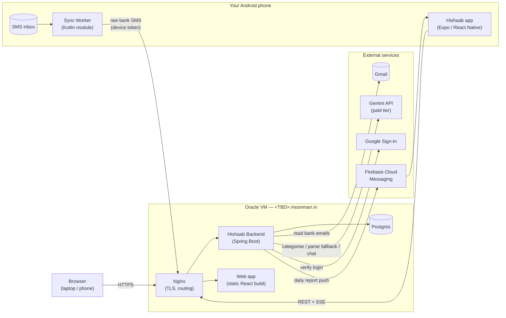

### 3.2 The three parts in one line each

| Part | Job | Lives on |
|---|---|---|
| **Sync Worker** | Reads new bank SMS since last sync and uploads them raw. Nothing else. | Android phone (inside the app) |
| **Backend** | Stores raw messages, pulls emails, parses, dedups, categorises, builds the daily report, answers chat. | Oracle VM |
| **UI** | Shows the dashboard, transactions, review list, settings and chat. | Web (browser) + Android app |

### 3.3 One day in the life of a transaction

Diagram file: `diagrams/02-daily-flow.mmd`

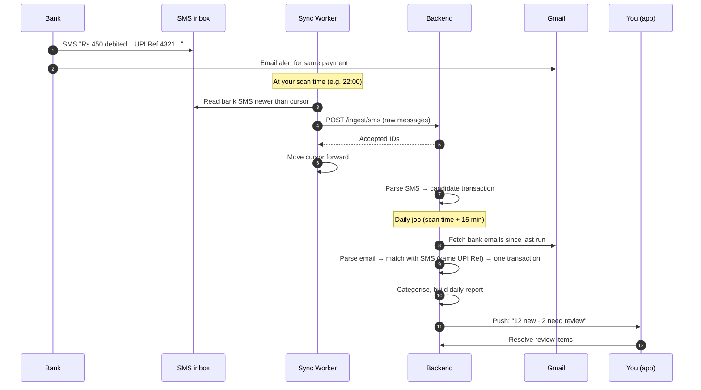

---

## 4. Backend

### 4.1 Tech stack

| Concern | Choice |
|---|---|
| Language / runtime | OpenJDK 25 (LTS). Next planned upgrade: JDK 29 LTS |
| Framework | Spring Boot 3 (web, security, data JPA, validation, actuator) |
| LLM access | Spring AI with Gemini (billed Google Cloud project) |
| Database | Postgres 16+, Flyway for migrations |
| API docs / client | springdoc-openapi → generates TypeScript client for both apps |
| Scheduling | Spring `TaskScheduler` + `CronTrigger`, cron stored in DB |
| Email | Gmail API (read-only) — see open item O-02 |
| Push | Firebase Cloud Messaging (FCM) |
| Packaging | Docker image, run with Docker Compose |

### 4.2 Modules

One deployable app, split into modules with clear borders. A module only talks to another through its public service interface.

Diagram file: `diagrams/03-backend-modules.mmd`

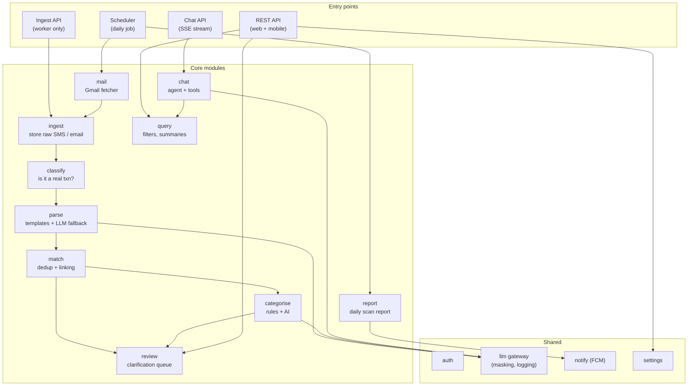

| Module | Owns |
|---|---|
| `ingest` | Accepting raw messages, hash IDs, rejecting repeats |
| `mail` | Gmail login token, fetching bank emails by sender, turning them into raw messages |
| `classify` | Deciding: completed transaction, or OTP / promo / reminder / failed / balance alert |
| `parse` | Bank-specific regex templates; LLM fallback for unknown formats |
| `match` | Dedup and linking (SMS↔email, refunds, transfers, card bill payments) |
| `categorise` | Category rules, merchant aliases, AI suggestions |
| `review` | The clarification queue and your answers |
| `query` | All reads for the UI: lists, filters, summaries, totals |
| `chat` | The chat agent and its read-only tools |
| `report` | Daily scan report + push notification |
| `auth` | Google login, passkeys (via Google), device tokens, API tokens, dev-only password login |
| `llm` | One gateway for every Gemini call: masking, timeouts, logging, cost tracking |

### 4.3 Processing pipeline

Every message, SMS or email, goes through the same steps.

Diagram file: `diagrams/04-ingestion-pipeline.mmd`

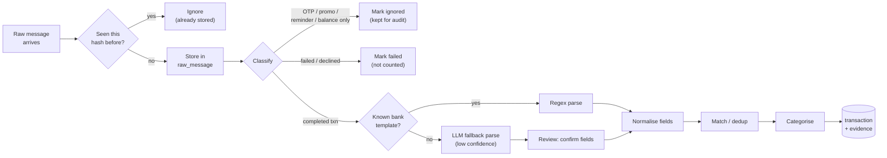

**Classify first.** Most bank SMS are *not* completed transactions. Counting OTPs, mandate reminders ("will be debited"), declined payments or balance alerts as spend would make the dashboard wrong. Ignored messages are still kept, marked with why they were ignored.

**Normalised fields** (output of parsing):

| Field | Example | Notes |
|---|---|---|
| `amount_paise` | `45000` | Integer. ₹450.00 = 45000 |
| `direction` | `DR` / `CR` | Debit or credit |
| `account_last4` | `1234` | Never the full number |
| `channel` | `UPI`, `CARD`, `NEFT`, `IMPS`, `ATM`, `AUTOPAY` | |
| `counterparty_raw` | `SWIGGY*BLR` | Cleaned later into a merchant |
| `ref_no` | UPI ref / RRN | Strongest dedup key |
| `txn_time` | `2026-11-17T21:42+05:30` | From message text if present, else received time |
| `balance_after_paise` | `1234500` | Optional. Used for balance checks |

### 4.4 Dedup and matching

Three layers. Each one catches a different kind of duplicate.

| Layer | Catches | Rule |
|---|---|---|
| **L1 — same message** | The worker uploading the same SMS twice | Primary key = `sha256(sender + body + received_at)`. Database rejects repeats. For email, the Gmail message ID. |
| **L2 — SMS ↔ email** | Same payment reported by SMS and by email | Same `ref_no` → same transaction. No ref → match on amount + direction + account + time window. |
| **L3 — look-alike payments** | Two real ₹50 payments at the same shop, same day | **Two messages from the same source are always separate transactions unless they share a `ref_no`.** |

Diagram file: `diagrams/05-dedup-matching.mmd`

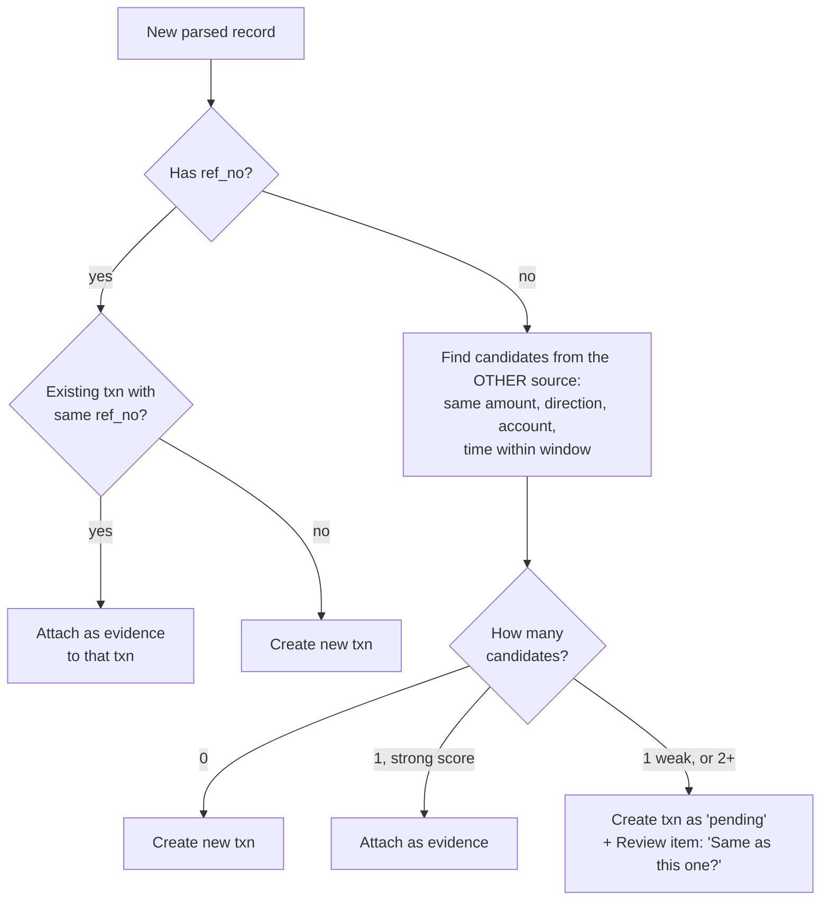

Matching settings (stored in `settings`, tuned after real data):

| Setting | Start value |
|---|---|
| SMS ↔ email time window | 3 hours (emails often arrive late) |
| Strong match score | all of: amount, direction, account last 4, channel equal |
| Same-source merge | never, unless `ref_no` matches |

**One transaction, many proofs.** A transaction has one or more **evidence** rows (the messages that report it). Merging or splitting only moves evidence links, so it can always be undone.

**Special kinds that would break totals if missed:**

| Kind | What you see | How it is handled |
|---|---|---|
| `cc_payment` | Bank debit + credit card credit | Not spend. The card purchases are the spend. Otherwise everything is counted twice. |
| `transfer` | Debit in SBI + credit in Axis (your own accounts) | Not spend, not income. |
| `refund` | Credit from a merchant you paid earlier | Linked to the original; reduces that category's spend. |
| `reversal` | Failed UPI money returned | Cancels the original; both hidden from totals. |
| `investment` | SIP / RD / FD debit matching one of your investment schedules | Not spend. Shown as its own "invested" total and confirms the instalment (§4.13). |

When the system cannot tell which kind it is, it asks in Review.

### 4.5 Categorisation

Your choices always win. AI only fills gaps.

Diagram file: `diagrams/06-category-resolution.mmd`

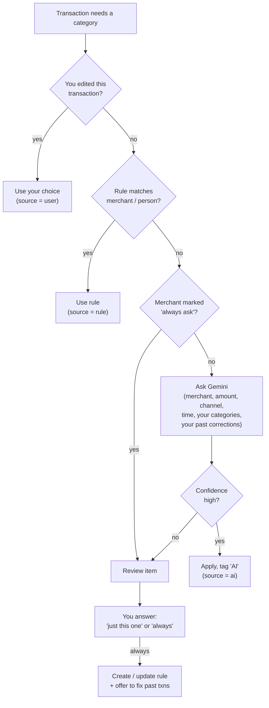

Rules:

- An AI result is a **first guess**, not a rule. Only your confirmations become rules.
- Nothing ever overwrites a category **you** set: not AI, not a rule change, not a rebuild.
- **UPI to a person** (e.g. "Rahul K"): AI cannot know if it is rent, a dinner split or a loan. Always ask, then save a rule per person.
- **Mixed merchants** (Amazon, Flipkart, Instamart): can be marked "always ask". Splitting one transaction across categories is supported.
- Categories are nested (`Food → Groceries`) and fully editable: create, rename, merge, delete.

### 4.6 Where AI is used (and where it is not)

| Place | AI? | Input sent to Gemini | Output |
|---|---|---|---|
| Classify | ❌ | — | — |
| Parse known formats | ❌ | — | — |
| Parse **unknown** formats | ✅ fallback | Masked message text | Strict JSON of fields + confidence → always Review |
| Dedup / matching | ❌ | — | — |
| Categorise **unknown** merchants | ✅ | Merchant name, amount, channel, time, category list, few past corrections | Category + confidence |
| Chat | ✅ | Your question + tool results | Answer in plain language |

**All AI calls go through one `llm` gateway** that:
- masks long digit runs, phone numbers and email addresses before sending,
- sets timeouts and retries,
- logs every prompt and response (in your own DB) with model version and cost,
- uses a **billed** Google Cloud project, so prompts are not used to improve Google's products.

No multi-agent setup. Each agent hop is one more place for a wrong number to slip in.

### 4.7 Data model

Diagram file: `diagrams/07-data-model.mmd`

```mermaid
erDiagram
    RAW_MESSAGE ||--o| PARSED_RECORD : "parsed into"
    PARSE_TEMPLATE ||--o{ PARSED_RECORD : "used by"
    PARSED_RECORD ||--o{ TRANSACTION_EVIDENCE : "proves"
    TRANSACTION ||--|{ TRANSACTION_EVIDENCE : "has"
    ACCOUNT ||--o{ TRANSACTION : "on"
    MERCHANT ||--o{ TRANSACTION : "with"
    MERCHANT ||--o{ MERCHANT_ALIAS : "known as"
    CATEGORY ||--o{ TRANSACTION : "in"
    CATEGORY ||--o{ CATEGORY : "parent of"
    CATEGORY ||--o{ CATEGORY_RULE : "target of"
    TRANSACTION ||--o{ REVIEW_ITEM : "raises"
    RAW_MESSAGE ||--o{ USER_OVERRIDE : "anchors"
    SCAN_RUN ||--o{ REVIEW_ITEM : "reports"
    DEVICE ||--o{ RAW_MESSAGE : "uploaded"
    CHAT_SESSION ||--o{ CHAT_MESSAGE : "contains"
    ACCOUNT ||--o{ INVESTMENT : "debited from"
    INVESTMENT ||--o{ INSTALMENT : "expects"
    INSTALMENT ||--o{ INSTALMENT_EVIDENCE : "proven by"
    TRANSACTION ||--o| INSTALMENT_EVIDENCE : "bank debit"
    RAW_MESSAGE ||--o{ INSTALMENT_EVIDENCE : "allotment / failed msg"

    RAW_MESSAGE {
        string id PK "sha256 or Gmail msg id"
        string source "SMS or EMAIL"
        string sender
        text body
        timestamptz received_at
        timestamptz ingested_at
        string status "NEW PARSED IGNORED FAILED"
        string ignore_reason
        uuid device_id FK
    }
    PARSE_TEMPLATE {
        uuid id PK
        string bank
        string sender_pattern
        text regex
        int version
        bool active
    }
    PARSED_RECORD {
        uuid id PK
        string raw_message_id FK
        uuid template_id FK "null if LLM"
        string parser "TEMPLATE or LLM"
        bigint amount_paise
        string direction
        string account_last4
        string channel
        string counterparty_raw
        string ref_no
        timestamptz txn_time
        bigint balance_after_paise
        float confidence
    }
    TRANSACTION {
        uuid id PK
        bigint amount_paise
        string direction
        timestamptz txn_time
        uuid account_id FK
        uuid merchant_id FK
        uuid category_id FK
        string category_source "USER RULE AI NONE"
        float ai_confidence
        string ai_model_version
        string kind "SPEND INCOME TRANSFER REFUND CC_PAYMENT REVERSAL"
        string status "CONFIRMED PENDING HIDDEN"
        string ref_no
        text note
    }
    TRANSACTION_EVIDENCE {
        uuid transaction_id FK
        uuid parsed_record_id FK
        string match_method "REF WINDOW MANUAL"
        float score
    }
    ACCOUNT {
        uuid id PK
        string bank "AXIS SBI"
        string type "SAVINGS CREDIT_CARD"
        string last4
        string nickname
    }
    MERCHANT {
        uuid id PK
        string name
        string type "MERCHANT PERSON"
        uuid default_category_id FK
        bool always_ask
    }
    MERCHANT_ALIAS {
        uuid merchant_id FK
        string raw_name
    }
    CATEGORY {
        uuid id PK
        string name
        uuid parent_id FK
        string icon
        string color_token
    }
    CATEGORY_RULE {
        uuid id PK
        string match_type "MERCHANT PERSON KEYWORD"
        string match_value
        uuid category_id FK
        int priority
    }
    REVIEW_ITEM {
        uuid id PK
        string type "AMBIGUOUS_MATCH UNPARSED UNKNOWN_CATEGORY UNKNOWN_KIND LOW_CONFIDENCE BALANCE_GAP"
        jsonb payload
        string status "OPEN RESOLVED DISMISSED"
        jsonb resolution
        uuid scan_run_id FK
        timestamptz resolved_at
    }
    USER_OVERRIDE {
        uuid id PK
        string raw_message_id FK
        string field "CATEGORY KIND MERGE SPLIT NOTE HIDE"
        jsonb value
        timestamptz created_at
    }
    SCAN_RUN {
        uuid id PK
        timestamptz started_at
        timestamptz finished_at
        int sms_in
        int emails_in
        int txns_created
        int txns_merged
        int review_opened
        int errors
        string status
    }
    DEVICE {
        uuid id PK
        string name
        string token_hash
        timestamptz last_sync_at
        string fcm_token
    }
    CHAT_SESSION {
        uuid id PK
        timestamptz created_at
    }
    CHAT_MESSAGE {
        uuid id PK
        uuid session_id FK
        string role
        text content
        jsonb tool_calls
    }
    INVESTMENT {
        uuid id PK
        string name
        string type "SIP RD FD PPF OTHER"
        bigint amount_paise
        uuid account_id FK
        string frequency "MONTHLY QUARTERLY YEARLY EVERY_N_DAYS EVERY_N_MONTHS ONE_TIME"
        int interval_n
        int schedule_day "1-31; 29-31 clamp to month end"
        date start_date
        date end_date
        date maturity_date
        string match_text "folio / scheme / mandate words"
        int grace_days
        bool active
    }
    INSTALMENT {
        uuid id PK
        uuid investment_id FK
        date due_date
        bigint expected_paise
        string status "SCHEDULED CONFIRMED MARKED_PAID MISSED SKIPPED FAILED"
        string status_source "AUTO USER"
    }
    INSTALMENT_EVIDENCE {
        uuid instalment_id FK
        uuid transaction_id FK "bank debit, if any"
        string raw_message_id FK "allotment / failed msg, if any"
        string kind "BANK_DEBIT AMC_CONFIRMATION FAILED_DEBIT"
    }
```

Other tables not drawn: `settings` (cron, windows, thresholds), `app_user`, `api_token`, `llm_call_log`, `audit_log`. `user_override` can also target an instalment (key = investment + due date), so status changes you make survive rebuilds. Later: `budget`, `recurring_series`.

**Storage rules**

| Rule | Why |
|---|---|
| Money is `bigint` paise, never float | No rounding errors |
| All times are `timestamptz`; shown in IST | No time-zone bugs |
| `raw_message` is append-only | It is the source of truth (D-06) |
| `transaction` can be rebuilt from raw + overrides | Fix a bug, re-run, keep your edits (D-22) |
| Unique constraints on `raw_message.id` and `(source, ref_no)` where present | The database itself blocks duplicates |
| One processing worker at a time (Postgres advisory lock) | Two workers matching the same message at once is how duplicates get in |
| Every change by you is logged in `audit_log` | You can see who/what changed a transaction |

### 4.8 Review (clarification) queue

Diagram file: `diagrams/08-review-lifecycle.mmd`

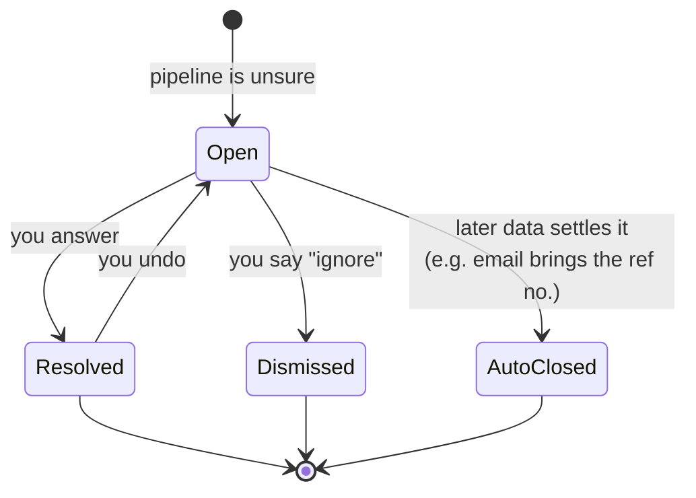

| Review type | Question shown to you |
|---|---|
| `AMBIGUOUS_MATCH` | "Is this SMS and this email the same payment?" |
| `UNPARSED` / `LOW_CONFIDENCE` | "We read this as ₹450 debit to Swiggy. Correct?" |
| `UNKNOWN_CATEGORY` | "What is this payment to Rahul K?" |
| `UNKNOWN_KIND` | "Is this a transfer between your accounts?" |
| `BALANCE_GAP` | "Your SBI balance doesn't add up between 12 and 14 Nov. A message may be missing." |

Pending transactions **are shown** in lists (marked "needs review") but are **left out of totals** until confirmed. The dashboard shows how much money is pending, so totals are never silently wrong.

### 4.9 Daily scan and report

Diagram file: `diagrams/09-daily-scan.mmd`

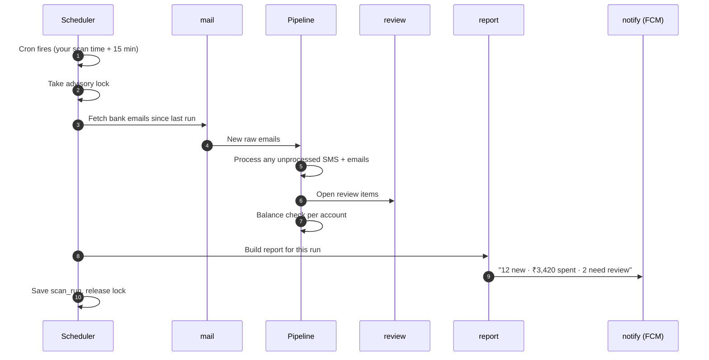

- The scan time is stored as a cron string in `settings` and changed from the Settings screen. No redeploy needed.
- SMS are processed **as soon as they arrive**. The daily job pulls emails, re-runs matching and sends the report.
- **Investments in the report:** instalments confirmed in this run, instalments due in the next 7 days, and instalments that became missed (§4.13).
- **Balance check:** most bank SMS include the available balance. The backend compares it with its own running balance. A gap means a missed or misread message, and creates a `BALANCE_GAP` review item. This is the strongest reliability check in the system.

### 4.10 Chat

Diagram file: `diagrams/10-chat-sequence.mmd`

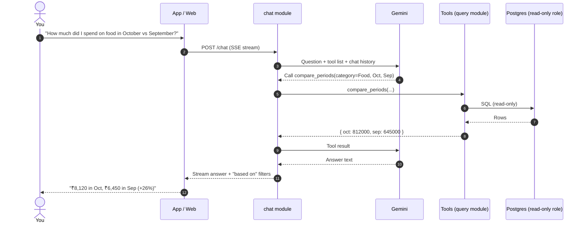

**Tools the chat agent gets (all read-only):**

| Tool | Does |
|---|---|
| `search_transactions(filters)` | List matching transactions (capped rows) |
| `summarise(group_by, period, filters)` | Totals by category / merchant / account / day |
| `compare_periods(a, b, filters)` | Side-by-side totals |
| `top_merchants(period, n)` | Biggest spends |
| `list_review_items()` | What still needs your answer |
| `get_categories()` | Your category tree |

Rules:
- **Numbers come only from tool results.** The model explains, it does not do maths on its own.
- Every answer shows the filters it used, so you can open the same view and check.
- Tools run on a **read-only database role**. Chat cannot change data in v1.
- Later: chat may *propose* a change ("Re-categorise these 4 as Travel?") that you confirm in the UI.

### 4.11 API surface

| Area | Endpoints |
|---|---|
| Ingest (worker) | `POST /ingest/sms`, `GET /device/config` |
| Transactions | `GET /transactions?filters&sort&cursor`, `GET /transactions/{id}`, `PATCH /transactions/{id}`, `POST /transactions/{id}/split`, `POST /transactions/merge` |
| Summary | `GET /summary?period=&filters` |
| Review | `GET /review`, `POST /review/{id}/resolve`, `POST /review/{id}/dismiss` |
| Categories | `GET/POST/PATCH/DELETE /categories`, `GET/POST/PATCH/DELETE /rules`, `POST /rules/{id}/apply-past` |
| Accounts / merchants | `GET/PATCH /accounts`, `GET/PATCH /merchants` |
| Sync | `GET /scan-runs/latest`, `GET /scan-runs`, `POST /scan-runs` (run now) |
| Investments | `GET/POST/PATCH/DELETE /investments`, `GET /investments/{id}/instalments`, `GET /instalments?status&from&to`, `PATCH /instalments/{id}` |
| Settings | `GET/PATCH /settings` (scan time, sender allowlist, thresholds) |
| Chat | `POST /chat` (SSE), `GET /chat/sessions` |
| Auth | `/oauth2/*`, `POST /auth/mobile/google`, `POST /auth/refresh`, `POST /devices`, `POST /api-tokens` |
| Ops | `/actuator/health` |

The OpenAPI spec is generated from code and used to generate the TypeScript client (`packages/api`). Any backend change that breaks the apps shows up as a type error at build time.

### 4.12 Testing the backend

| Test | What it protects |
|---|---|
| **Parser golden set** — synthetic SMS/emails per bank and fund house, modelled on the shapes of real samples (D-25), plus expected output | Banks change formats without notice. A failing test tells you which template broke. |
| Dedup scenarios — SMS-only, email-only, both, late email, two look-alike payments, refund, card bill payment | The core promise (G1, G2) |
| Rebuild test — wipe transactions, rebuild from raw + overrides, compare | D-06, D-22 |
| Contract test — OpenAPI spec diff in CI | Apps don't break silently |

### 4.13 Investments and SIP schedules

Diagram file: `diagrams/19-instalment-lifecycle.mmd`

**What it is.** You enter your investments once: SIPs, recurring deposits, fixed deposits/locked funds, PPF or anything else that debits on a schedule. The backend turns each schedule into expected **instalments** and confirms them from your bank and fund-house messages. Investment debits are **not spend** (D-24).

**What you enter:** name, type (`SIP`, `RD`, `FD`, `PPF`, `OTHER`), amount, account it is debited from, frequency (monthly, quarterly, yearly, every N days, every N months, one-time), schedule day (29–31 fall on the last day of shorter months), start date, optional end date, optional lock-in/maturity date, active flag, and optional match words (folio number, scheme name, mandate name).

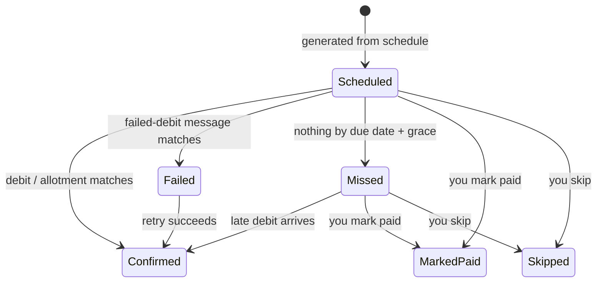

**Two kinds of proof per SIP instalment**

| Message | Example shape | What it does |
|---|---|---|
| Bank debit (SMS/email from the bank) | "INR 1,000 debited … ACH/NACH … <fund house>" | Becomes a transaction with kind `INVESTMENT` and confirms the instalment |
| Fund-house allotment (SMS/email from the AMC) | "Your SIP purchase … Rs.999.95 … processed … units allotted … NAV" | Confirms the instalment. **Never creates a transaction** (it is not a separate money movement). Amount is net of stamp duty, so ₹1,000 shows as ₹999.95. |
| Fund-house reminder | "… will be debited on 05/11/2026" | Ignored (classified as a reminder) |
| Failed debit | "… debit failed / bounced …" | Marks the matching instalment `FAILED` |

**Matching rules**
- An instalment matches a message when **all** hold: amount equal (bank debit) or within the stamp-duty tolerance (allotment); same account when both sides know it; message date within the instalment's window (a few days before/after the due date); and the investment's match words appear in the text (when you set any).
- **Two or more instalments match → nothing is confirmed; a review item asks you which.** Never a guess.
- A debit that looks like an investment (SIP, NACH/ACH to a fund house, "mutual fund", folio …) but matches no schedule → the transaction stays `PENDING` and Review asks: **"Create SIP schedule from this?"** (or "Not an investment" → normal spend).
- `MISSED` = still unconfirmed after due date + grace days. A late debit still confirms it.
- **Your schedule is the source of truth.** Instalments are generated from it whether or not any SMS/email ever arrives, and you can always mark one paid by hand (the way to record SIPs whose bank debit isn't parsed yet). Matching only adds automatic confirmation on top.
- You can change any instalment's status by hand. It is stored as a `user_override` and survives rebuilds; automatic rules never change a status you set.

**Totals.** `INVESTMENT` is excluded from spend and income. The summary shows a separate **invested** total (confirmed + marked-paid instalments in the period).

**UI screens**

| Screen | Shows | Backend call |
|---|---|---|
| **Investments** (under More) | List of investments with next due date, this month's status, invested this month/year | `GET /investments`, `GET /summary` |
| **Investment detail / edit** | Schedule fields, instalment timeline with status chips (scheduled, confirmed, paid, missed, skipped, failed), linked messages; actions: mark paid, skip, undo | `GET /investments/{id}/instalments`, `PATCH /instalments/{id}` |
| **Add investment** | Form with live preview of the next 6 instalment dates | `POST /investments` |
| **Dashboard** | "Invested" tile beside spent/received; "Upcoming investments (7 days)" strip | `GET /summary`, `GET /instalments?status=SCHEDULED` |
| **Review** | "Which SIP is this?" and "Create SIP schedule from this?" cards | `GET /review` |

---

## 5. Sync Worker (Android)

### 5.1 What it does — and what it does not

| Does | Does not |
|---|---|
| Read SMS from **allowed bank senders only** | Read personal texts or OTPs from other senders |
| Upload them **raw** to the backend | Parse, categorise or dedup |
| Remember the **last synced message** (cursor) | Keep its own queue or database of transactions |
| Run once a day at your scan time, plus "Sync now" | Run constantly in the background |
| Report its status to the app | Show its own screens (UI lives in the app) |

### 5.2 How it is built

- A small **Kotlin module** inside the Expo app (Expo Modules API).
- Uses Android's **ContentResolver** to read the SMS inbox and **WorkManager** to schedule runs.
- Built in the cloud with **EAS Build**, so your laptop does not need Android Studio or the Android SDK.
- The React Native UI talks to it through a tiny bridge: `getStatus()`, `syncNow()`, `setSchedule()`, `requestPermissions()`.

### 5.3 Sync run

Diagram file: `diagrams/11-worker-sync.mmd`

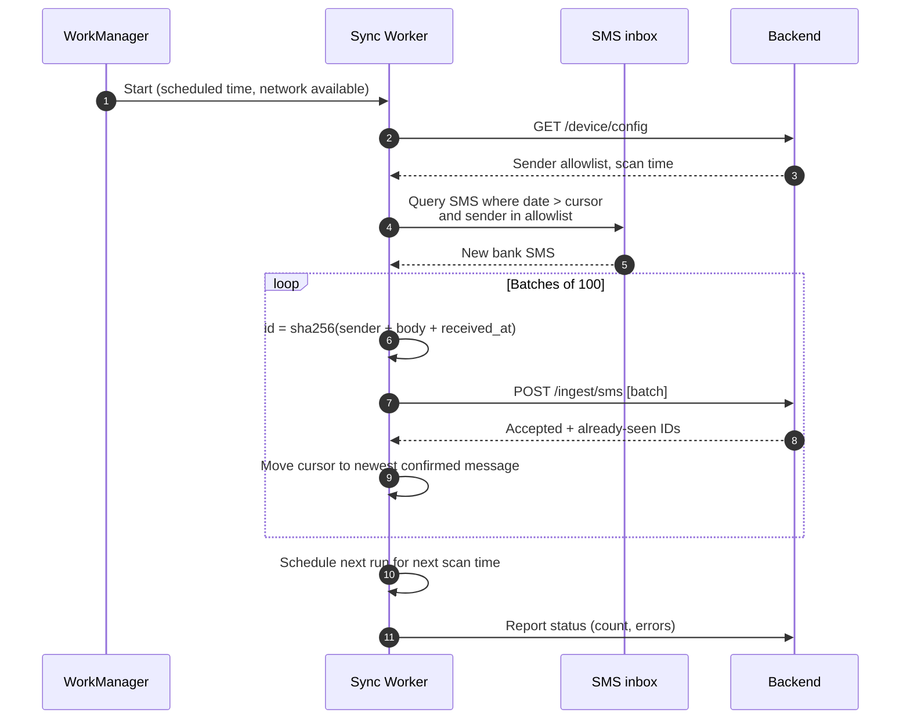

**Why this design is safe:**

- The cursor moves **only after the server confirms**. If the upload fails halfway, the next run starts from the last confirmed message.
- Re-sending a message is harmless: the server already knows its ID (L1 dedup).
- If the phone is off, asleep or out of network, the next run picks up everything since the cursor. Nothing is lost.

### 5.4 Worker states

Diagram file: `diagrams/12-worker-states.mmd`

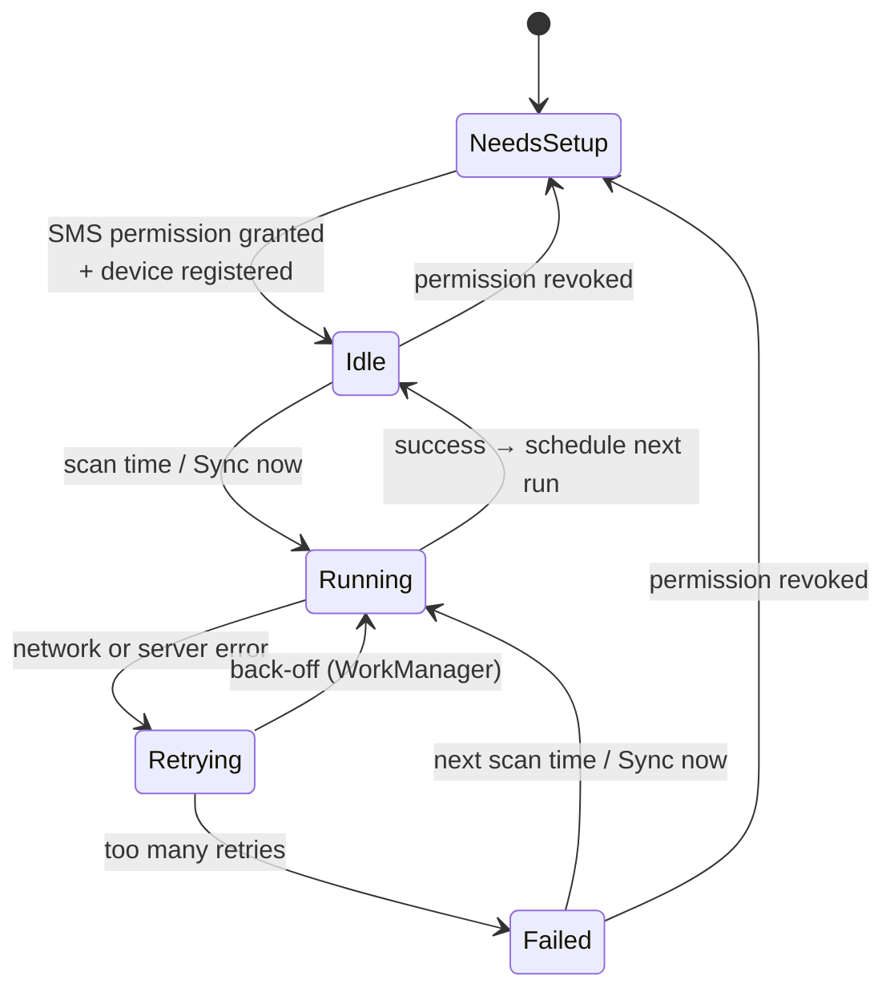

### 5.5 Scheduling

- WorkManager does **not** run at an exact time. Android may delay work to save battery. This is fine: the cursor makes late runs catch up.
- Daily schedule = a one-time job with a delay until the next scan time, re-scheduled after each run.
- Constraint: network connected.
- Scan time comes from the backend (`GET /device/config`), so changing it on the web also changes the phone.

### 5.6 First install

1. Sign in with Google → app registers the device and gets a **device token** (can only call ingest endpoints).
2. Ask for SMS permission. Explain why on screen first.
3. Ask to be excluded from battery optimisation (improves run reliability).
4. **Backfill:** read the **last 1 month** of bank SMS and upload.
5. Backend backfills the last 1 month of bank emails.
6. First report shows: transactions found + review items.

### 5.7 Sender allowlist

- Indian bank SMS come from header IDs like `XX-AXISBK-S`. Only the middle part is stable.
- The allowlist is stored on the backend (Settings) and matched on that middle part.
- **For now the allowlist is open (`"*"` = every sender, D-26)** because fund-house sender IDs vary. The worker therefore receives `"*"` and must apply its own filter (bank and fund-house senders only) before uploading; otherwise OTPs and personal SMS would leave the phone. Narrow the list to explicit IDs in Settings once they are known.
- During setup, the app lists the senders in your inbox so you can tick the bank ones. Exact IDs for Axis, SBI and your mutual-fund houses are collected from **your** phone, not guessed.

---

## 6. UI — Web and Android

### 6.1 Repo layout

Diagram file: `diagrams/13-ui-monorepo.mmd`

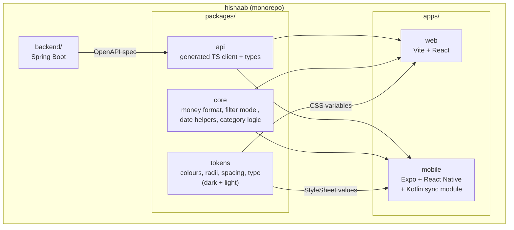

**What is shared and what is not**

| Shared (packages) | Built separately per platform |
|---|---|
| API client and types | Screens and layouts |
| Money and date formatting | Navigation |
| Filter model (same object sent to API) | Charts (different libraries, same data shape) |
| Category tree helpers | Gestures (hover on web, swipe on mobile) |
| Design tokens | Component code (CSS vs StyleSheet) |

### 6.2 Design language

Inspired by your friend's Finance Studio app, adapted for touch, with your own logo and assets.

| Keep (the look) | Change (for touch and for this app) |
|---|---|
| Near-black background with see-through white panels | Hover-to-reveal row actions → **swipe** actions and long-press on mobile |
| Very round cards and pill buttons | Left sidebar → **bottom tab bar** on mobile |
| Urbanist font, Material Symbols icons | Icons fill on the **active** tab, not on hover |
| Big bold italic amounts | Large corner radii scaled down on small screens |
| Active nav item = solid pill with inverted text | Debit/credit shown with **sign and arrow**, not only red/green |
| Status dots and progress bars (gold / green / red) | Add charts (his app has none) |
| — | Add a **light theme** (his app is dark only) |

**Tokens** (named once, values per theme):

| Token | Dark | Light |
|---|---|---|
| `bg.page` | near black | off-white |
| `bg.panel` | white @ ~9% | black @ ~4% |
| `bg.control` | dark grey | light grey |
| `text.primary` / `soft` / `muted` | light greys | dark greys |
| `accent.gold` | warm yellow | darker yellow for contrast |
| `money.credit` | green | darker green |
| `money.debit` | readable red (not the dark background red) | darker red |
| `status.review` | orange | darker orange |
| `radius.card` / `radius.pill` | 32 / 36 (web), 20 / 24 (mobile) | same |

Exact values are set during visual design. Every colour must pass contrast checks in both themes.

**Core components:** PillButton, Card, MetricCard, AmountLockup, StatusDot, ProgressBar, TxnRow, FilterChips, ReviewCard, CategoryPicker, SyncStatusBar, ChatBubble.

### 6.3 Navigation and screens

Diagram file: `diagrams/14-ui-navigation.mmd`

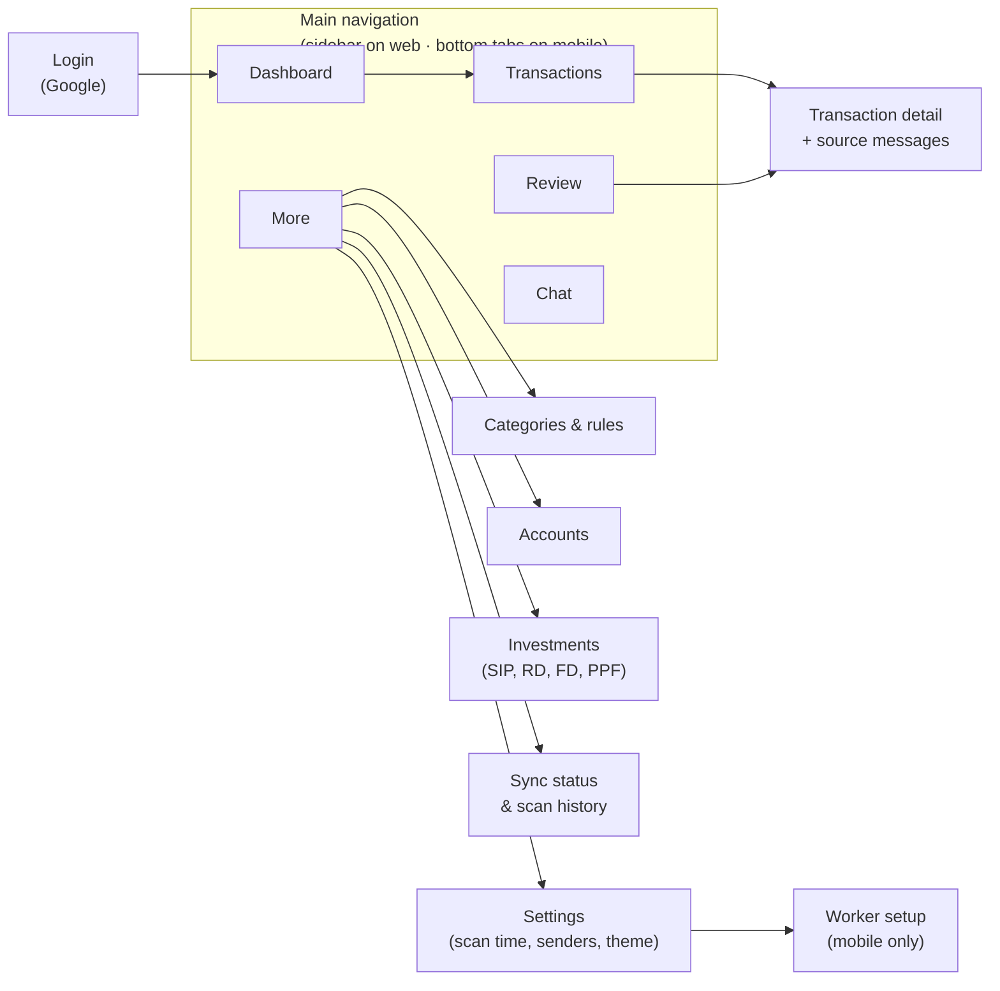

| Screen | Shows | Backend call |
|---|---|---|
| **Dashboard** | Spent / received this month, by category, top merchants, pending amount, freshness bar | `GET /summary` |
| **Transactions** | Filterable, sortable list grouped by day | `GET /transactions` |
| **Transaction detail** | All fields, category history, **the original SMS/email** | `GET /transactions/{id}` |
| **Review** | Cards with one question each and quick answers | `GET /review`, `POST /review/{id}/resolve` |
| **Categories & rules** | Category tree, rules, "apply to past" | `/categories`, `/rules` |
| **Accounts** | Axis (savings + credit card), SBI; nickname, balance check status, **card aliases** (debit-card last 4 → account), merge | `/accounts` |
| **Investments** | Schedules and instalment status (see §4.13) | `/investments`, `/instalments` |
| **Sync status** | Last sync per device, last scan run, errors | `/scan-runs` |
| **Settings** | Scan time, sender allowlist, theme, devices, API tokens | `/settings` |
| **Chat** (built last) | Conversation with streamed answers + "based on" filters | `POST /chat` |
| **Worker setup** (mobile) | Permissions, battery exemption, sender picker, first backfill | Kotlin module + `/devices` |

### 6.4 Filtering, sorting, grouping

One filter object in `packages/core`, used by both apps and sent to the API as-is. On web it is also kept in the URL so views can be bookmarked.

| Filter | Options |
|---|---|
| Date | Today, this week, this month, last month, custom range |
| Direction | Debit, credit |
| Kind | Spend, income, transfer, refund, card payment, investment |
| Account | Axis, Axis credit card, SBI |
| Category | Multi-select, includes sub-categories |
| Merchant / person | Search + multi-select |
| Amount | Min / max |
| Channel | UPI, card, NEFT, IMPS, ATM, autopay |
| Source | SMS, email, both |
| Status | Confirmed, needs review |
| Category source | Yours, rule, AI |
| Text | Search across merchant, note, ref no. |

Sort by date, amount or merchant. Group by day, week, month, category, merchant or account. All filtering and totals happen **on the server** (D-18). Lists use cursor-based paging.

### 6.5 How the UI talks to the backend

Diagram file: `diagrams/15-ui-data-flow.mmd`

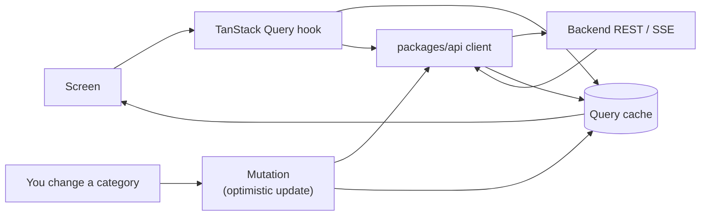

- **TanStack Query** in both apps for caching, retries and instant feedback when you edit.
- Money shown with Indian grouping (`₹1,23,456`) via `Intl.NumberFormat('en-IN')`. Paise convert to rupees **only at display time**.
- Times always shown in IST.
- Chat answers stream over **SSE**.

### 6.6 Rules that keep the UI trustworthy

| Rule | Example |
|---|---|
| **Always show freshness** | "Last synced 6h ago · 3 need review" at the top of the dashboard |
| **Every transaction links to its proof** | Tap → see the original SMS/email |
| **Show where a category came from** | Small tag: *You*, *Rule*, *AI* |
| **Pending is visible, never hidden** | "₹1,240 pending review" shown next to totals |
| **Errors are loud** | Failed sync or scan shows a banner, not a silent empty screen |
| **Empty / loading / error states** designed for every screen | — |

### 6.7 Mobile-only features

- **Push notification** after each daily scan, opening the Review screen.
- **Read-only offline cache** of the last loaded data.
- Worker setup, permission and sync status screens.
- Swipe actions on transaction rows (re-categorise, add note, hide).

---

## 7. Security and privacy

### 7.1 Login

Diagram file: `diagrams/16-auth.mmd`

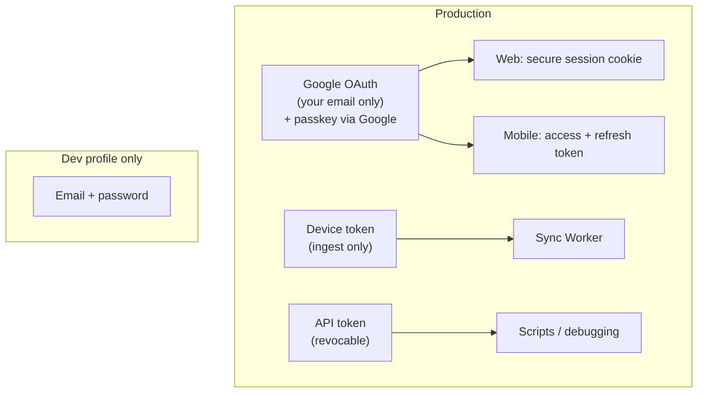

| Method | Production | Dev | Can do |
|---|---|---|---|
| Google OAuth, allowlisted to your email | ✅ | ✅ | Everything |
| Passkey (through your Google account) | ✅ | ✅ | Everything |
| Email + password | ❌ (endpoint does not exist) | ✅ | Everything |
| API token | ✅ revocable | ✅ | Read + chosen write scopes |
| Device token | ✅ | ✅ | **Only** upload SMS and read device config |
| Mobile OTP | ❌ | ❌ | — (D-14) |

Turn on 2-step verification on your Google account; it now protects your financial data too.

### 7.2 Data protection

| Risk | Protection |
|---|---|
| OTPs and personal texts leaving the phone | Sender allowlist on the phone; only bank SMS are read |
| Stolen phone uploads junk | Device token can only ingest; revoke from Settings |
| LLM provider sees too much | Billed Gemini project; masking in `llm` gateway; AI only sees merchant-level data, never full message history |
| Secrets in Git | `.env` files never committed; `.env.example` only; secret scanning in CI |
| Database leak | Postgres not exposed to the internet; disk encryption on VM; backups encrypted |
| Chat changes data | Read-only DB role for chat tools |

---

## 8. Hosting and operations

Diagram file: `diagrams/17-deployment.mmd`

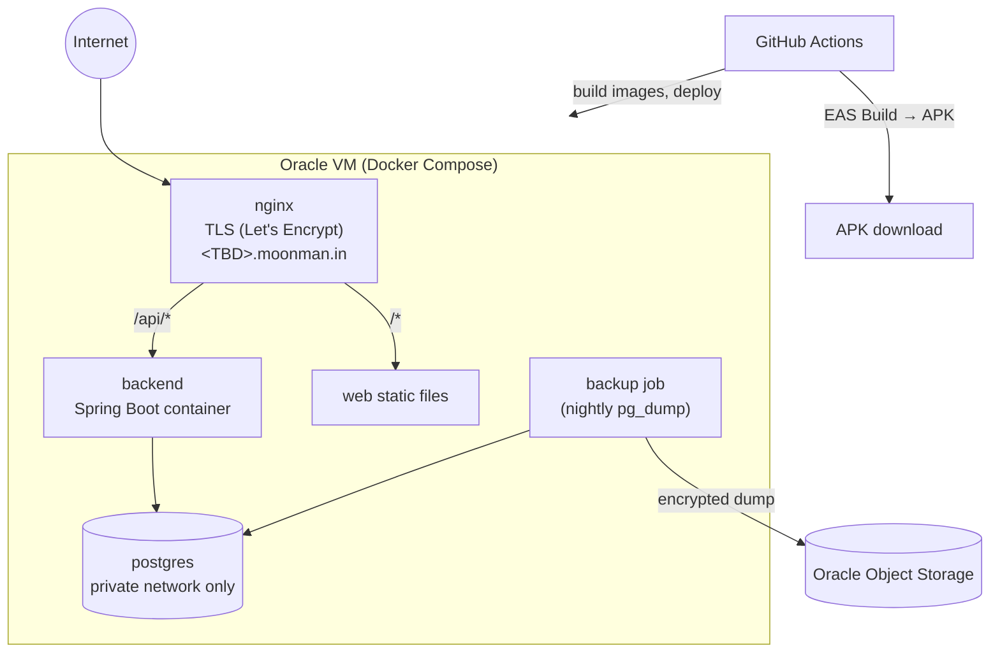

| Area | Plan |
|---|---|
| Deploy | GitHub Actions builds the backend image and web bundle, deploys to the VM |
| Android build | EAS Build in the cloud → APK you install on your phone |
| Backups | Nightly encrypted `pg_dump` to Oracle Object Storage; keep 30 days; **test a restore monthly** |
| Health | `/actuator/health` + external uptime check |
| Alerts | Failed scan run or parse-failure spike → push notification to you |
| Logs | Structured logs; never log full message bodies at INFO level |
| Migrations | Flyway, run on startup |

This database becomes your only financial record. Backups are not optional.

---

## 9. Build order (MVP first)

Diagram file: `diagrams/18-build-order.mmd`

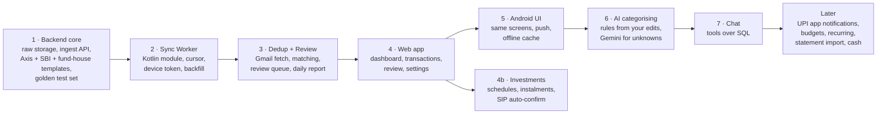

Chat comes last because it is only as good as the data under it.

**MVP "done" means:** one month of real Axis + SBI data (plus your SIP instalments confirmed), with zero known duplicates, every transaction traceable to its message, the balance check passing for every account, and the review list empty after you answer it.

---

## 10. Risks and open items

### 10.1 Risks

| Risk | Impact | Mitigation |
|---|---|---|
| Bank changes SMS/email format | Transactions missed or misread | Golden test set; unparsed messages go to Review; balance check catches gaps |
| Android delays or kills the worker | Late data | Cursor-based catch-up; battery exemption; "Sync now"; freshness banner |
| Same-amount payments wrongly merged | Spend under-counted | Same-source never merged without ref no. (L3) |
| SMS and email both missed | Transaction missing | Balance check; later, statement import |
| LLM gives a wrong category | Wrong category totals | AI only for unknown merchants; tagged "AI"; low confidence → Review |
| Server outage | No sync | Phone keeps SMS in inbox; next run catches up |
| Data loss on VM | Lose all history | Nightly encrypted backups, monthly restore test |

### 10.2 Open items

| ID | Item | Notes |
|---|---|---|
| O-01 | Subdomain | `<TBD>.moonman.in` |
| O-02 | **Gmail access method** | Gmail API needs an OAuth app. If that app stays in Google's "Testing" mode, refresh tokens may expire after about a week, breaking daily email fetch. Options: move the OAuth app to production status, or use IMAP with an app password. Verify before building `mail`. |
| O-03 | Exact sender IDs for Axis, SBI and your fund houses | Allowlist open (`"*"`) for now (D-26); pin IDs later from your phone |
| O-04 | Do you hold a super.money credit card? | If yes, add it as an account/source |
| O-05 | Chart libraries (web + mobile) | Pick maintained ones at UI build time |
| O-06 | SSE streaming in React Native | Confirm a working approach before building Chat on mobile |
| O-07 | Light theme exact values | Designed during visual design |
| O-08 | UPI app notifications (later) | Needs Android notification-access permission; useful for clearer merchant names |
| O-09 | Bank-side SIP debit message (SBI ACH/NACH debit SMS or email) | No sample yet. Not blocking: schedules hold regardless and instalments can be marked paid by hand. Until a template exists these debits go to Review as unparsed; fund-house allotments still confirm instalments. |

---

## 11. Glossary

| Term | Meaning |
|---|---|
| **Raw message** | The exact SMS or email text as received. Never changed. |
| **Parsed record** | Fields pulled out of one raw message. |
| **Transaction** | One real money movement. Can be proven by several messages. |
| **Evidence** | A link between a transaction and a message that reports it. |
| **Cursor** | The time of the newest SMS the server has confirmed. The worker reads after this. |
| **Dedup** | Making sure each real transaction is stored once. |
| **Ref no. / RRN** | Unique reference number of a UPI or bank transfer. Best dedup key. |
| **Review item** | A question the system asks you instead of guessing. |
| **Override** | A change you made, stored separately so rebuilds keep it. |
| **Scan run** | One daily processing cycle, with its counts and errors. |
| **Device token** | A key that lets the phone upload SMS and nothing else. |
| **Paise** | 1/100 of a rupee. All money is stored in paise. |
| **SIP** | Systematic Investment Plan: a fixed amount invested in a mutual fund on a schedule. |
| **AMC** | Asset Management Company: the fund house. Sends SIP reminders and allotment messages. |
| **Instalment** | One expected payment of an investment schedule, with a status (scheduled, confirmed, …). |
| **Stamp duty (MF)** | 0.005% deducted from mutual-fund purchases; why a ₹1,000 SIP shows ₹999.95 allotted. |
